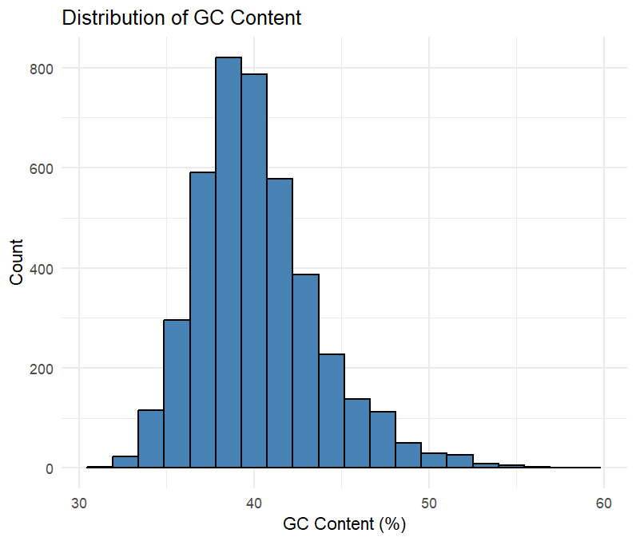

# Yeast Genome Analysis Pipeline

Scalable R pipeline for parsing yeast genomic sequences, computing nucleotide composition, quantifying GC content, simulating gene expression levels, and performing statistical analysis with publication-quality visualizations.

Built using **Biostrings** and **ggplot2**.

---

# Project Overview

Genomic sequence composition varies across genes and genomic regions and can influence structural and functional properties such as genome organization, codon usage, and transcriptional activity.

This project:

- Parses FASTA-formatted yeast genomic sequence files
- Computes nucleotide frequencies (A, T, G, C)
- Calculates GC content for each gene
- Determines gene lengths from nucleotide sequences
- Simulates gene expression levels for modeling demonstration
- Performs correlation and linear regression analyses
- Generates publication-quality visualizations to summarize genomic trends

The pipeline is modular, reproducible, and scalable for larger genomic datasets.

---

# Tools & Technologies

- R
- Biostrings (Bioconductor) — sequence parsing and nucleotide frequency analysis
- ggplot2 — statistical visualization
- Base R statistical modeling and hypothesis testing
- FASTA sequence processing

---

# Pipeline Workflow

## 1. Sequence Parsing

Reads multiple FASTA-formatted yeast sequence files and processes each sequence independently.

### Workflow

- Reads all sequence files from the specified directory
- Removes FASTA header records
- Cleans and concatenates nucleotide sequences
- Converts sequences to uppercase
- Removes non-DNA characters when present
- Uses `alphabetFrequency()` from Biostrings to compute nucleotide counts

### Outputs Per Gene

| Feature | Description |
|----------|------------|
| Gene | Sequence identifier |
| Length | Total sequence length (bp) |
| A | Adenine count |
| T | Thymine count |
| G | Guanine count |
| C | Cytosine count |
| GC Content | Percentage of G and C bases |

---

## 2. GC Content Calculation

GC content is calculated for every gene sequence using:

```r
GC_Content = ((G + C) / (A + T + G + C)) * 100
```

The resulting values are stored in a structured data frame for downstream analyses.

---

## 3. Gene Length Characterization

Gene length is calculated as the total number of nucleotide bases in each sequence.

Gene-length distributions are summarized and visualized to evaluate variation across the yeast genome.

---

## 4. Simulated Gene Expression

For demonstration purposes, gene expression values are simulated using a normal distribution:

```r
set.seed(123)

Expression_Level <- rnorm(
  n = number_of_genes,
  mean = 10,
  sd = 2
)
```

Reproducibility is ensured using a fixed random seed.

---

## 5. Statistical Analysis

### Correlation Analysis

Pearson correlation tests are performed to evaluate relationships between GC content and expression levels.

### Linear Regression

Linear models are fit using:

```r
Expression_Level ~ GC_Content
```

Outputs include:

- Regression coefficients
- p-values
- R² statistics
- Confidence intervals

These analyses demonstrate how genomic sequence features may be evaluated against biological response variables.

---

## 6. Data Export

Processed datasets are exported for downstream analyses and reproducibility.

### Output Files

- `yeast_gene_summary.csv`
- `top_gc_genes.csv`

---

# Visualizations

## Figure 1. Distribution of GC Content

**Generated File:** `# Yeast Genome Analysis Pipeline

Scalable R pipeline for parsing yeast genomic sequences, computing nucleotide composition, quantifying GC content, simulating gene expression levels, and performing statistical analysis with publication-quality visualizations.

Built using **Biostrings** and **ggplot2**.

---

# Project Overview

Genomic sequence composition varies across genes and genomic regions and can influence structural and functional properties such as genome organization, codon usage, and transcriptional activity.

This project:

- Parses FASTA-formatted yeast genomic sequence files
- Computes nucleotide frequencies (A, T, G, C)
- Calculates GC content for each gene
- Determines gene lengths from nucleotide sequences
- Simulates gene expression levels for modeling demonstration
- Performs correlation and linear regression analyses
- Generates publication-quality visualizations to summarize genomic trends

The pipeline is modular, reproducible, and scalable for larger genomic datasets.

---

# Tools & Technologies

- R
- Biostrings (Bioconductor) — sequence parsing and nucleotide frequency analysis
- ggplot2 — statistical visualization
- Base R statistical modeling and hypothesis testing
- FASTA sequence processing

---

# Pipeline Workflow

## 1. Sequence Parsing

Reads multiple FASTA-formatted yeast sequence files and processes each sequence independently.

### Workflow

- Reads all sequence files from the specified directory
- Removes FASTA header records
- Cleans and concatenates nucleotide sequences
- Converts sequences to uppercase
- Removes non-DNA characters when present
- Uses `alphabetFrequency()` from Biostrings to compute nucleotide counts

### Outputs Per Gene

| Feature | Description |
|----------|------------|
| Gene | Sequence identifier |
| Length | Total sequence length (bp) |
| A | Adenine count |
| T | Thymine count |
| G | Guanine count |
| C | Cytosine count |
| GC Content | Percentage of G and C bases |

---

## 2. GC Content Calculation

GC content is calculated for every gene sequence using:

```r
GC_Content = ((G + C) / (A + T + G + C)) * 100
```

The resulting values are stored in a structured data frame for downstream analyses.

---

## 3. Gene Length Characterization

Gene length is calculated as the total number of nucleotide bases in each sequence.

Gene-length distributions are summarized and visualized to evaluate variation across the yeast genome.

---

## 4. Simulated Gene Expression

For demonstration purposes, gene expression values are simulated using a normal distribution:

```r
set.seed(123)

Expression_Level <- rnorm(
  n = number_of_genes,
  mean = 10,
  sd = 2
)
```

Reproducibility is ensured using a fixed random seed.

---

## 5. Statistical Analysis

### Correlation Analysis

Pearson correlation tests are performed to evaluate relationships between GC content and expression levels.

### Linear Regression

Linear models are fit using:

```r
Expression_Level ~ GC_Content
```

Outputs include:

- Regression coefficients
- p-values
- R² statistics
- Confidence intervals

These analyses demonstrate how genomic sequence features may be evaluated against biological response variables.

---

## 6. Data Export

Processed datasets are exported for downstream analyses and reproducibility.

### Output Files

- `yeast_gene_summary.csv`
- `top_gc_genes.csv`

---

# Visualizations

## Figure 1. Distribution of GC Content



**Caption**

Histogram showing the distribution of GC content (%) across yeast gene sequences. Most genes exhibit GC contents between approximately 35% and 45%, with a peak around 39–40%, indicating moderate variability in nucleotide composition across the dataset.

---

## Figure 2. Distribution of Gene Lengths

**Generated File:** `Distribution of Gene Lengths.png`

**Caption**

Histogram displaying the distribution of gene lengths (base pairs). The distribution is strongly right-skewed, with most genes ranging from approximately 500–2500 bp and a smaller number of substantially longer genes extending beyond 5000 bp.

---

## Figure 3. GC Content vs Expression Level

**Generated File:** `GC Content Vs Expression Level.png`

**Caption**

Scatterplot illustrating the relationship between GC content (%) and simulated gene expression levels. Each point represents a gene sequence. The fitted linear regression line and corresponding confidence interval indicate the overall association between sequence composition and expression characteristics.

---

# Example Applications

This workflow demonstrates common computational biology and bioinformatics techniques including:

- Genome sequence parsing
- Nucleotide composition analysis
- GC content profiling
- Exploratory genomic data analysis
- Statistical modeling
- Biological data visualization
- Reproducible computational workflows

---

# Resume-Relevant Summary

Developed a reproducible R-based bioinformatics pipeline to parse FASTA-formatted yeast genomic sequences, calculate nucleotide composition and GC content, simulate gene expression distributions, and perform statistical analyses of sequence features. Generated publication-quality visualizations using Biostrings and ggplot2 to summarize genomic trends and evaluate relationships between sequence composition and expression patterns.Rplot01.png`

**Caption**

Histogram showing the distribution of GC content (%) across yeast gene sequences. Most genes exhibit GC contents between approximately 35% and 45%, with a peak around 39–40%, indicating moderate variability in nucleotide composition across the dataset.

---

## Figure 2. Distribution of Gene Lengths

**Generated File:** `Rplot02.png`

**Caption**

Histogram displaying the distribution of gene lengths (base pairs). The distribution is strongly right-skewed, with most genes ranging from approximately 500–2500 bp and a smaller number of substantially longer genes extending beyond 5000 bp.

---

## Figure 3. GC Content vs Expression Level

**Generated File:** `Rplot03.png`

**Caption**

Scatterplot illustrating the relationship between GC content (%) and simulated gene expression levels. Each point represents a gene sequence. The fitted linear regression line and corresponding confidence interval indicate the overall association between sequence composition and expression characteristics.

---

# Example Applications

This workflow demonstrates common computational biology and bioinformatics techniques including:

- Genome sequence parsing
- Nucleotide composition analysis
- GC content profiling
- Exploratory genomic data analysis
- Statistical modeling
- Biological data visualization
- Reproducible computational workflows

---

# Resume-Relevant Summary

Developed a reproducible R-based bioinformatics pipeline to parse FASTA-formatted yeast genomic sequences, calculate nucleotide composition and GC content, simulate gene expression distributions, and perform statistical analyses of sequence features. Generated publication-quality visualizations using Biostrings and ggplot2 to summarize genomic trends and evaluate relationships between sequence composition and expression patterns.
